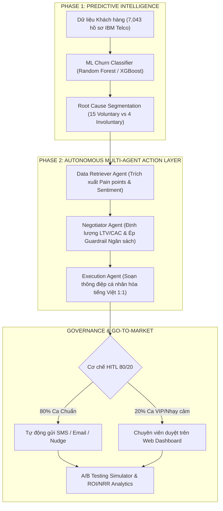

# 📄 BẢN THUYẾT MINH ĐỀ TÀI / DỰ ÁN DỰ THI
## HỆ THỐNG AI ĐA TÁC TỬ TỰ ĐỘNG DỰ BÁO VÀ GIỮ CHÂN KHÁCH HÀNG
### (Autonomous Multi-Agent Churn Prediction & Retention Action Platform)

---

## I. THÔNG TIN ĐĂNG KÝ KẾT QUẢ DỰ KIẾN

### 1. Kết quả dự kiến hoàn thành sau cuộc thi:
- [x] **Prototype** *(Hệ sinh thái thử nghiệm hoàn chỉnh quy trình end-to-end từ dự báo rủi ro đến tự động can thiệp giữ chân)*
- [x] **Website** *(Ứng dụng Web dành cho đội ngũ CSKH, Chuyên viên Marketing và Cấp quản lý)*
- [ ] Mobile App
- [x] **Dashboard** *(Bảng điều khiển trực quan hóa chỉ số Churn Rate, NRR, ROI, phân bổ lý do rời mạng và giám sát Guardrail)*
- [x] **AI Model** *(Pipeline Machine Learning dự báo rời mạng & bóc tách nguyên nhân + Hệ thống 3 tác tử AI Multi-Agent can thiệp cá nhân hóa)*
- [x] **Hệ thống quản trị** *(Cơ chế Human-In-The-Loop (HITL) phân quyền phê duyệt, kiểm soát trần chi phí và bảo vệ dữ liệu PII)*
- [ ] Khác

### 2. Mô tả ngắn sản phẩm dự kiến (Executive Summary):
> **Hệ thống AI Đa Tác Tử Tự Động Giữ Chân Khách Hàng** là giải pháp công nghệ toàn diện kết hợp giữa **Machine Learning (Phase 1)** để dự báo nguy cơ & bóc tách chính xác lý do rời mạng, cùng **Hệ thống Multi-Agent AI (Phase 2)** để tự động hóa chiến lược can thiệp cá nhân hóa 1:1 theo thời gian thực. Giải pháp tích hợp **cơ chế Guardrail tài chính (CAC/CRC)** bảo vệ biên lợi nhuận, **hệ thống kiểm duyệt HITL (Human-in-the-loop)** và **Web Dashboard quản trị trực quan**, giúp doanh nghiệp viễn thông/dịch vụ số tối ưu hóa NRR (Net Retention Rate) và nâng cao ROI giữ chân khách hàng.

---

## II. BỐI CẢNH VÀ BÀI TOÁN KINH DOANH (BUSINESS CASE)

### 1. Bối cảnh thị trường
* **Chi phí thu hút khách hàng mới (CAC) leo thang:** Chi phí tìm kiếm một khách hàng mới đắt gấp **5 đến 25 lần** so với chi phí giữ chân khách hàng hiện tại (CRC).
* **Tác động của việc giữ chân đến lợi nhuận:** Việc tăng tỷ lệ giữ chân khách hàng thêm **5%** có thể thúc đẩy lợi nhuận của doanh nghiệp tăng từ **25% đến 95%**.
* **Hiệu ứng "Lỗ hổng đáy thùng" (Leaky Bucket):** Trong các mô hình kinh doanh thuê bao/dịch vụ định kỳ (Viễn thông, SaaS, Dịch vụ số), tỷ lệ rời bỏ khách hàng (*Churn Rate*) dù ở mức 4-5% vẫn là rào cản chí mạng triệt tiêu hoàn toàn tăng trưởng doanh thu kép.

### 2. "Điểm nghẽn" của các giải pháp truyền thống
1. **Dừng lại ở mức cảnh báo (Passive Prediction):** Các mô hình Machine Learning truyền thống chỉ đưa ra điểm số rủi ro (*Churn Probability*) mà không có "Lớp hành động" (*Action Layer*), buộc đội ngũ CSKH phải xử lý thủ công, dẫn đến độ trễ cao và bỏ lỡ "thời điểm vàng" để giữ chân.
2. **Lãng phí ngân sách ưu đãi (Blanket Retention):** Doanh nghiệp thường tung voucher/chiết khấu giảm giá đại trà mà không phân loại được:
   * **Voluntary Churn (Tự nguyện rời mạng do giá/chất lượng):** Cần can thiệp chiến lược.
   * **Involuntary Churn (Bất khả kháng do chuyển nhà, qua đời, ngoài vùng phủ):** Bù tiền giảm giá là hoàn toàn vô ích và lãng phí.
3. **Thiếu cá nhân hóa sâu sắc 1:1:** Khách hàng nhận được những tin nhắn mẫu dập khuôn, làm giảm mức độ hài lòng và tỷ lệ chuyển đổi.

---

## III. MỤC TIÊU VÀ GIẢI PHÁP ĐỀ XUẤT

Dự án phát triển nền tảng **Churn Retention Phase 1 & Phase 2** nhằm tự động hóa hoàn toàn chu trình từ **Phân tích $\rightarrow$ Ra quyết định $\rightarrow$ Thực thi can thiệp $\rightarrow$ Đo lường ROI**:

---

## IV. CÁC THÀNH PHẦN KỸ THUẬT CỐT LÕI (CORE MODULES)

### 1. Module 1: AI Model Dự Báo & Bóc Tách Nguyên Nhân (Phase 1)
* **Thuật toán cốt lõi:** Huấn luyện mô hình Random Forest / Machine Learning trên tập dữ liệu viễn thông thực tế (IBM Telco Churn dataset với hơn 7,000 bản ghi).
* **Phân tầng nguyên nhân rời mạng (Ground Truth Categorization):**
  * **Voluntary Churn (15 nguyên nhân):** Cước phí cao (*Price too high*), đối thủ khuyến mãi (*Competitor offers*), chất lượng hỗ trợ kém (*Poor support attitude*)... $\rightarrow$ Phân bổ ngân sách giữ chân mục tiêu.
  * **Involuntary Churn (4 nguyên nhân):** Chuyển nơi ở (*Moved*), qua đời (*Deceased*), ngoài vùng phủ (*Network reliability/range*)... $\rightarrow$ Kích hoạt tính năng **Bảo lưu gói (Pause Subscription)** thay vì tung ưu đãi giảm giá gây thâm hụt tài chính.

### 2. Module 2: Hệ Thống AI Đa Tác Tử (Multi-Agent Retention Workflow - Phase 2)
Kiến trúc gồm 3 AI Agent phối hợp chuyên sâu qua cơ chế chia sẻ ngữ cảnh:
* 🕵️ **Data Retriever Agent:** Phân tích log tương tác, bóc tách điểm đau (*Pain points*), mức độ bức xúc (*Sentiment Analysis*) và tổng hợp chân dung khách hàng.
* ⚖️ **Negotiator Agent:** Đóng vai trò là "Nhà đàm phán tài chính", phân tích Customer Lifetime Value (CLV) và phân khúc kinh doanh (*True Friends, Butterflies, Barnacles, Strangers*) để đề xuất gói ưu đãi tối ưu.
* ✍️ **Execution Agent:** Tự động soạn thảo thông điệp cá nhân hóa bằng tiếng Việt tự nhiên, phù hợp theo từng kênh liên lạc (SMS, Email, hoặc kịch bản cho điện thoại viên gọi điện trực tiếp).

### 3. Module 3: Lớp Kiểm Soát An Toàn (Guardrails & Governance)
* 🛡️ **Financial Guardrail (`_enforce_guardrail`):** Khóa cứng trần ngân sách chiết khấu, đảm bảo chi phí giữ chân (CRC) luôn nhỏ hơn giá trị thặng dư LTV của từng nhóm khách hàng.
* 🔒 **Privacy Guard (Bảo vệ PII):** Cơ chế lọc và ẩn danh hóa thông tin định danh cá nhân (Họ tên, SĐT, Số CCCD, Địa chỉ) trước khi gửi dữ liệu sang các mô hình ngôn ngữ lớn (LLM), tuân thủ **Nghị định 13/2023/NĐ-CP** và GDPR.
* 👥 **Human-In-The-Loop (HITL):** Thiết lập tỷ lệ **80% Tự động hóa : 20% Giám sát chuyên gia**. Các ca khách hàng VIP, khách hàng có nguy cơ cao hoặc yêu cầu chi phí lớn sẽ được chuyển về hàng đợi để chuyên viên duyệt trước khi phát hành.

### 4. Module 4: Web Dashboard & Hệ Thống Quản Trị (Frontend & Backend)
* **Backend:** Xây dựng trên **FastAPI**, cung cấp hệ thống RESTful API thời gian thực xử lý Pipeline AI, quản lý Cohort và giả lập kết quả.
* **Frontend:** Giao diện SPA hiện đại xây dựng bằng **React + TypeScript + Vite + Tailwind CSS** gồm 4 phân hệ chính:
  1. *Executive Overview:* Theo dõi biến động Churn Rate, cơ cấu lý do rời mạng, phân bổ rủi ro.
  2. *Customer Cohort Explorer:* Lọc, tra cứu hồ sơ khách hàng, xem lịch sử tương tác và phân tích từ Agent.
  3. *HITL Review Center:* Giao diện trực quan để chuyên viên xem trước, chỉnh sửa và phê duyệt thông điệp giữ chân.
  4. *ROI & NRR Analytics:* So sánh hiệu quả thực tế giữa nhóm can thiệp (*Treatment*) và nhóm đối chứng (*Holdout*), minh bạch hóa doanh thu cứu vãn và tỷ suất ROI.

---

## V. KẾT QUẢ ĐẦU RA VÀ SẢN PHẨM BÀN GIAO (DELIVERABLES)

| STT | Hạng mục bàn giao | Mô tả chi tiết |
| :---: | :--- | :--- |
| **1** | **Mã nguồn hoàn chỉnh (Full Source Code)** | - Mã nguồn Backend FastAPI, Frontend React Vite, Pipeline AI Agents. - Cấu trúc module hóa rõ ràng, dễ bảo trì và mở rộng. |
| **2** | **Bản chạy thử nghiệm (Live Interactive Prototype)** | - Hệ thống Web App tương tác trực tiếp dữ liệu thực tế 7,043 khách hàng. - Cho phép chạy thử nghiệm quy trình can thiệp và kiểm duyệt HITL ngay trên giao diện. |
| **3** | **Bộ Mô hình & Pipeline AI (AI Models & Agents)** | - Pipeline Machine Learning Phase 1 dự báo Churn. - Hệ thống 3 AI Agents (Retriever, Negotiator, Execution) với bộ Prompt tiếng Việt tối ưu. |
| **4** | **Bảng điều khiển Quản trị (Interactive Dashboard)** | - Dashboard phân tích đa chiều: Tỷ lệ rời mạng, Net Retention Rate (NRR), Gross Revenue Retention (GRR) và ROI chiến dịch. |
| **5** | **Tài liệu Kỹ thuật & Báo cáo Đề tài (Documentation)** | - Báo cáo kiến trúc hệ thống, tài liệu API, hướng dẫn cài đặt & triển khai thực tế. |

---

## VI. HIỆU QUẢ KINH TẾ VÀ TÁC ĐỘNG THỰC TIỄN

1. **Tối ưu hóa Chi phí Vận hành (Cost Reduction):**
   * Giảm thiểu đến **60-80%** thời gian thủ công của nhân viên CSKH trong việc đọc log và soạn tin nhắn phản hồi.
   * Cắt giảm **100%** chi phí khuyến mãi lãng phí cho các trường hợp Involuntary Churn.
2. **Nâng cao Tỷ lệ Giữ chân & Doanh thu:**
   * Tăng tỷ lệ khách hàng đồng ý ở lại nhờ thông điệp cá nhân hóa đúng "nỗi đau" (*Pain point*).
   * Cải thiện trực tiếp chỉ số **Net Revenue Retention (NRR)** và kéo dài vòng đời khách hàng (LTV).
3. **Tuân thủ và Bảo mật Doanh nghiệp:**
   * Doanh nghiệp hoàn toàn an tâm về an toàn thông tin nhờ cơ chế mã hóa PII theo luật định Việt Nam.
