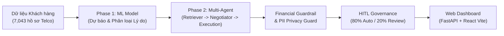

# 📋 BẢN ĐỀ XUẤT DỰ ÁN RÚT GỌN (EXECUTIVE PROPOSAL)
## HỆ THỐNG AI MULTI-AGENT DỰ BÁO & TỰ ĐỘNG GIỮ CHÂN KHÁCH HÀNG
**Dự án:** Churn Retention Phase 1 & Phase 2 Platform

---

### 1. KẾT QUẢ DỰ KIẾN HOÀN THÀNH (CHECKLIST)
- [x] **Prototype:** Luồng xử lý dữ liệu và can thiệp giữ chân end-to-end tự động.
- [x] **Website:** Cổng ứng dụng web cho đội ngũ CSKH và Chuyên viên Quản trị.
- [ ] Mobile App
- [x] **Dashboard:** Bảng điều khiển trực quan hóa tỷ lệ Churn, NRR, ROI và A/B Testing.
- [x] **AI Model:** ML Churn Prediction (Phase 1) + Hệ thống 3 AI Agents (Phase 2).
- [x] **Hệ thống quản trị:** Cơ chế kiểm soát tài chính Guardrail + Phê duyệt HITL + Bảo mật PII.
- [ ] Khác

---

### 2. MÔ TẢ TỔNG QUAN (ELEVATOR PITCH)
> **Nền tảng AI Đa Tác Tử Tự Động Giữ Chân Khách Hàng** kết hợp **Machine Learning (Phase 1)** để dự báo nguy cơ & bóc tách nguyên nhân rời mạng (*Voluntary vs Involuntary*), cùng **Hệ thống 3 AI Agents (Phase 2)** để tự động hóa chiến lược can thiệp 1:1 theo thời gian thực. Hệ thống tích hợp **Guardrail kiểm soát trần chi phí**, **cơ chế duyệt Human-In-The-Loop (80% AI / 20% Specialist)** và **Web Dashboard quản trị trực quan**, giúp doanh nghiệp tiết kiệm **30-60% chi phí vận hành** và tối ưu hóa chỉ số **Net Revenue Retention (NRR)**.

---

### 3. BÀI TOÁN & GIẢI PHÁP ĐỘT PHÁ

| Vấn đề của phương pháp truyền thống | Giải pháp đột phá của Dự án |
| :--- | :--- |
| **Chỉ cảnh báo, không có hành động:** Mô hình ML cũ chỉ chấm điểm Churn Score, CSKH xử lý thủ công gây chậm trễ. | **Lớp hành động tự động (Action Layer):** 3 AI Agents tự động đọc log, phân tích LTV/CAC và soạn thông điệp giữ chân tức thì. |
| **Tung ưu đãi đại trà, lãng phí:** Tặng voucher cho cả khách chuyển nhà, qua đời (Involuntary Churn). | **Bóc tách nguyên nhân & Financial Guardrails:** Tự động kích hoạt cơ chế bảo lưu gói thay vì giảm giá; khóa trần ngân sách CRC theo từng phân khúc. |
| **Thông điệp mẫu dập khuôn:** Tỷ lệ giữ chân thấp. | **Siêu cá nhân hóa 1:1 (Execution Agent):** Soạn tin nhắn tiếng Việt tự nhiên đánh trúng điểm đau (Pain points) của từng khách hàng. |
| **Rủi ro rò rỉ dữ liệu cá nhân:** | **Privacy Guard:** Ẩn danh hóa PII (SĐT, Họ tên, CCCD) theo **Nghị định 13/2023/NĐ-CP** & GDPR trước khi qua LLM. |

---

### 4. KIẾN TRÚC HỆ THỐNG TÓM GỌN

* **Module 1 (ML Engine):** Phân loại 15 lý do Voluntary (cần giữ) và 4 lý do Involuntary (cần bảo lưu gói).
* **Module 2 (Multi-Agent):**
  * *Data Retriever Agent:* Bóc tách pain points & sentiment từ log tương tác.
  * *Negotiator Agent:* Đàm phán gói cước tối ưu dựa trên LTV và phân khúc khách hàng.
  * *Execution Agent:* Soạn tin nhắn/kịch bản cuộc gọi cá nhân hóa tiếng Việt.
* **Module 3 (Web App & HITL Dashboard):** Frontend React Tailwind + Backend FastAPI giúp chuyên viên theo dõi cohort, duyệt ca nhạy cảm và đo lường ROI/NRR theo A/B testing (Treatment vs Holdout).

---

### 5. MÔ HÌNH KINH DOANH & KẾ HOẠCH TÀI CHÍNH (GTM STRATEGY)

* **Khách hàng mục tiêu (Target Customers):**
  * *Telecom & ISPs* (Tệp người dùng lớn, cần giảm churn quy mô lớn).
  * *B2B/B2C SaaS & Subscriptions* (Cần cải thiện chỉ số NRR & LTV).
  * *E-commerce Loyalty Programs*.
* **Định giá dựa trên giá trị thay thế (Value-Based Pricing):**
  * *Chi phí nhân sự hiện tại của DN:* ~$3,500 - $6,000/tháng (Data Analyst + Đội CSKH).
  * *Mức giá giải pháp (Tiết kiệm ~30-60% cho DN):*
    * **Phí cài đặt ban đầu (One-off Setup):** $1,500 - $3,000 (Tích hợp CRM, tùy chỉnh Guardrail).
    * **Phí thuê bao hàng tháng (SaaS Subscription):** $499/tháng (Starter) – $1,299/tháng (Pro) – $2,499+/tháng (Enterprise).
* **Cơ cấu chi phí (Cost Structure):** R&D & AI Engineers (45%), Cloud Hosting & Token API (25%), SG&A & Compliance (20%), Dự phòng & Thuế (10%).

---

### 6. KẾT QUẢ ĐẦU RA BÀN GIAO (DELIVERABLES)

1. **Full Source Code Repository:** Cấu trúc module hoàn chỉnh (FastAPI, React Vite, Multi-Agent Engine).
2. **Interactive Live Demo:** Web App chạy trên dữ liệu thật, mô phỏng luồng can thiệp và kiểm duyệt HITL.
3. **AI Pipeline & Notebooks:** Mô hình ML Phase 1, bộ Prompt tối ưu cho 3 AI Agents tiếng Việt.
4. **Interactive Dashboard:** Bảng điều khiển phân tích Churn Rate, NRR, Doanh thu cứu vãn và ROI thực tế.
5. **Tài liệu Kỹ thuật & Báo cáo đề tài:** Hướng dẫn triển khai, tài liệu API và case study kinh doanh.
